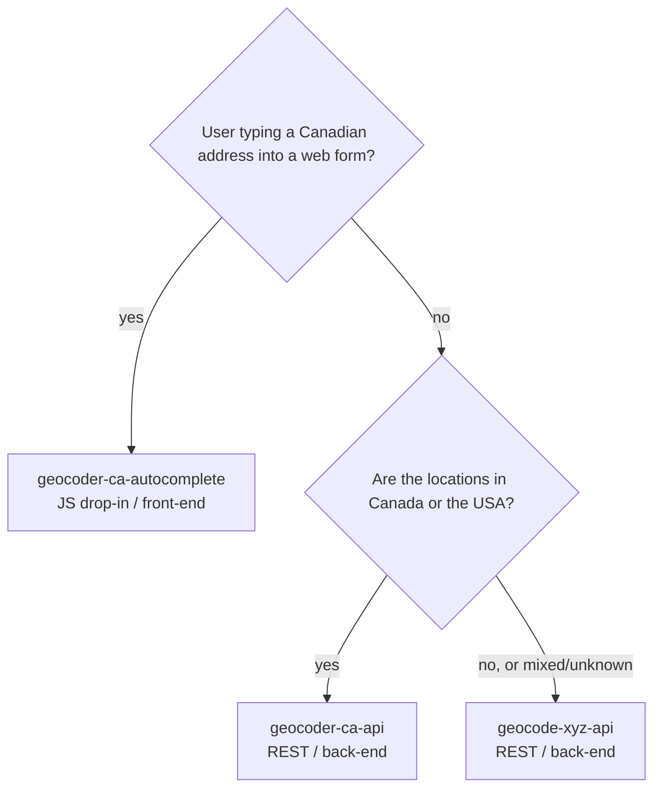

# geolytica-skills

Agent skills for working with the Geolytica geocoding services: [Geocoder.ca](https://geocoder.ca) (Canada and the USA) and [Geocode.xyz](https://geocode.xyz) (worldwide). They give an AI coding agent what it needs to integrate correctly: endpoints, parameters, response quirks, error handling, rate limits and per-language examples.

The skills are plain markdown files, so any agent that can read documentation can use them. Claude Code gets first-class installation through its plugin system; see [install.md](install.md) for Claude Code, Gemini CLI, Codex and other agents.

## Skills

| Skill | Purpose |
|---|---|
| `geocoder-ca-api` | Forward/reverse geocoding, address validation, postal code and ZIP+4 lookup, intersections, geoparsing, nearby places and census geography for Canada and the USA |
| `geocode-xyz-api` | Worldwide forward/reverse geocoding, geoparsing of free text, IP geolocation and street/postcode autocomplete |
| `geocoder-ca-autocomplete` | Dependency-free JavaScript drop-in for as-you-type Canadian address entry in a web form |

### Which skill do I need?

For mixed North American and international data, route each record by country: Canada/USA to Geocoder.ca, everything else to Geocode.xyz.

### Language references

Both API skills include `references/` files that the agent loads only when needed:

| Reference | geocoder-ca-api | geocode-xyz-api |
|---|---|---|
| `api-details.md` | Full parameter and response reference | Full parameter and response reference |
| `python.md` | ✓ | ✓ |
| `nodejs.md` | ✓ | ✓ |
| `perl.md` | ✓ (Geo::Coder::CA) | ✓ (Geo::Parser::Text) |
| `php.md` | ✓ | ✓ |
| `commandline.md` | curl and batch CSV | curl and batch CSV |

## Prerequisites

- **Geocoder.ca:** an auth token from [geocoder.ca](https://geocoder.ca/?register=1) (free non-commercial tier available; pay-per-use and unlimited plans at [geocoder.ca/pricing](https://geocoder.ca/pricing)). Store it in `GEOCODER_CA_AUTH`.
- **Geocode.xyz:** an auth key from [geocode.xyz](https://geocode.xyz/new_account). Store it in `GEOCODE_XYZ_AUTH`.

Both services also answer unauthenticated requests on a throttled free port, which is fine for trying things out but not for production.

## Machine-readable discovery

Geocoder.ca also publishes an RFC 9727 API catalog at `https://geocoder.ca/.well-known/api-catalog`, an OpenAPI 3.1 spec at `https://geocoder.ca/openapi.json`, and `llms.txt`. The skills in this repo are the agent-facing companion to those.

## About Geolytica

Geolytica Inc. (Ottawa, Canada) has run Geocoder.ca since 2005 and also operates [Geocode.xyz](https://geocode.xyz), the [POIDATA.XYZ](https://poidata.xyz) global points-of-interest dataset and [3geonames.org](https://3geonames.org). Licensed datasets, AWS Marketplace AMIs and self-hosted servers are available for volume work.

## License

MIT. See [LICENSE.txt](LICENSE.txt).
